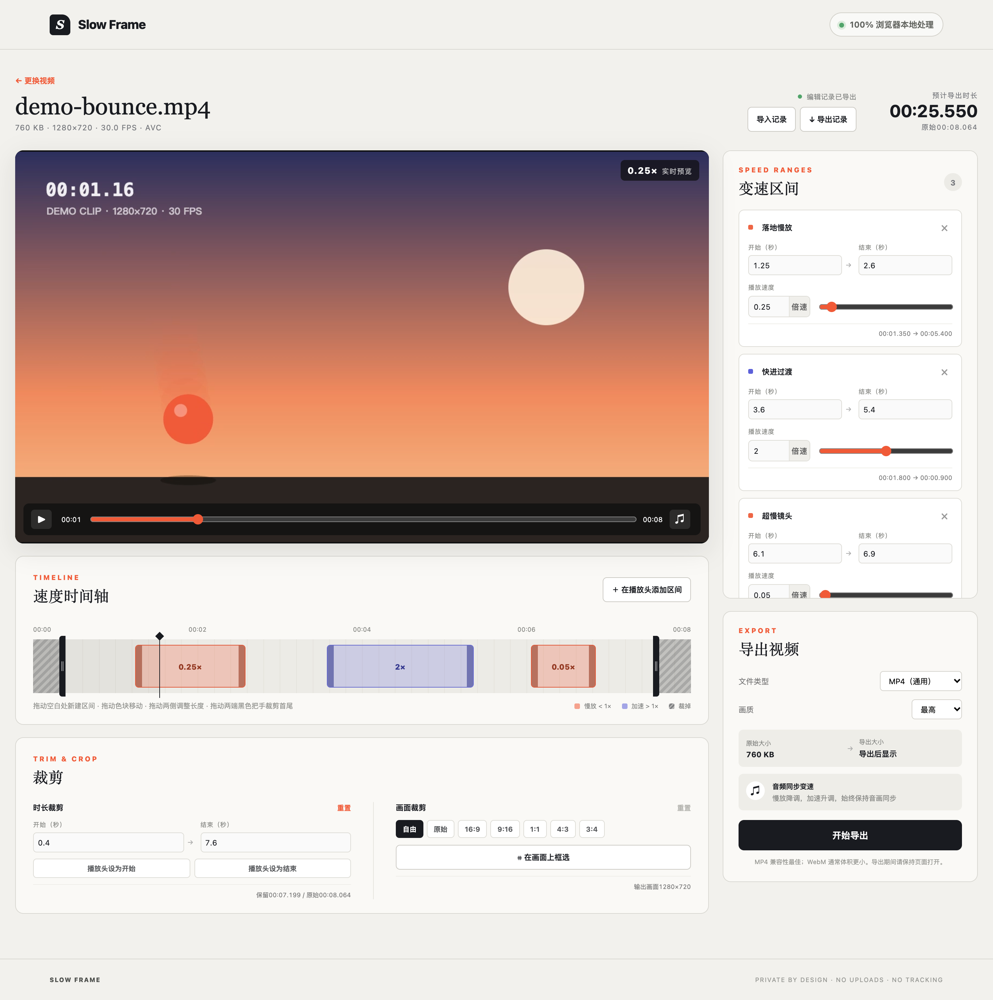

# slow-frame



纯前端的视频区间变速工具：在浏览器里选中视频的若干时间区间，对每段设置任意播放倍率（慢放或加速），配合时长裁剪、画面裁剪、镜像和水印 / 打码，最后直接在本地导出新视频。全程基于 WebCodecs，**视频文件不会上传到任何服务器**。

## 在线使用

访问 GitHub Pages：<https://hozeeee.github.io/slow-frame/>

网站通过 GitHub Actions 自动构建并部署。需要支持 WebCodecs 的现代浏览器，推荐使用最新版 Chrome、Edge 或 Safari。

## 功能

- **多格式导入**：支持 MP4 / MOV / WebM 等浏览器可解码的视频，导入时检查容器、视频和音频的编码支持情况。
- **区间变速**：在时间轴上拖动创建区间，每个区间可单独设置 `0.01×`–`16×` 的倍率，并支持拖拽调整、数值输入和命名；区间之间不允许重叠，拖动时会贴着相邻边界停住。
- **音频同步变速**：音频按线性插值重采样，时长与画面保持同步（类似磁带变速，慢放时音调变低）。
- **实时预览**：常规倍率直接用 `playbackRate` 预览；低于 `0.1×` 时改为逐帧时钟投递画面（静音）。
- **时长裁剪**：拖动时间轴两端的把手，只保留需要的片段。
- **画面裁剪**：在预览画面上框选区域，比例可选自由、原始、16:9、9:16、1:1、4:3、3:4。
- **画面镜像**：支持水平镜像（左右翻转）和垂直翻转（上下颠倒），可以同时开启。预览实时生效，已有的裁剪框会跟着画面一起翻转；导出时镜像直接写入画面，不依赖播放器识别变换元数据。
- **水印 / 打码**：最多 20 个图层，类型有文字、Emoji、图片、马赛克和纯色块，用来遮挡画面中的特定区域。
  - **关键帧**：暂停后拖动或缩放画面上的框，会自动在当前时间打一个关键帧（同一时间已有关键帧时直接修改它）；面板里可以跳到上一个 / 下一个关键帧、在当前时间补一个关键帧或删除关键帧。时间轴下方会用菱形标出选中图层的关键帧，点击即可跳转。
  - **平滑 / 定格**：关键帧之间默认线性插值、平滑移动；切换为“定格”后，框停在上一个关键帧的位置，到下一个关键帧时直接跳过去。
  - **显示时段**：每个图层可以单独设置出现和消失的时间。
  - 支持调整叠放顺序、不透明度、文字颜色和描边、马赛克块大小。预览和导出用的是同一套绘制逻辑；图层超出裁剪框的部分在导出时会被裁掉。
  - **图片不随编辑记录导出**：图片只保存在本浏览器的缓存里，导出的 JSON 编辑记录不包含图片。在别的浏览器导入 JSON 后，图片图层会显示为“图片缺失”，需要重新选择图片，否则导出时会跳过这些图层。
- **多格式导出**：

  | 格式 | 视频编码 | 音频编码 |
  | ---- | -------- | -------- |
  | MP4  | H.264    | AAC      |
  | MOV  | H.264    | AAC      |
  | WebM | VP9      | Opus     |

  画质可选“精简 / 均衡 / 最高”三档。导出前会先检查当前浏览器有没有对应的编码器，导出过程中可以取消。
- **编辑记录**：
  - 编辑状态自动缓存到 IndexedDB，重新打开同一视频（按文件名、大小、修改时间判断）时会提示恢复；
  - 支持把编辑记录导出为 JSON 文件，之后可以再导入；
  - 有修改但尚未导出时，离开页面会弹出提醒。
- **移动端界面**：手机上会自动切换到专门为触屏设计的界面，功能和桌面端一致（见下文）。

## 移动端

打开页面时会自动选择界面，不需要手动改地址：

- **手机**（触屏且屏幕短边不超过 600px，或 UA 标明为移动设备）：直接进入移动端。
- **平板、触屏笔记本或窄屏窗口**（视口宽度不超过 820px）：先进入桌面端，并在页面底部提示可以切换到移动版，由用户选择「切换到移动版」或「继续使用桌面版」。
- 两端都有切换入口：桌面端在页脚，移动端在欢迎页和「⋯」菜单里。
- 用户做过的选择会记在 `localStorage`（`slow-frame:ui`）中，之后直接打开页面就会使用该界面，也不会再提示。切换时页面会重新加载，当前编辑已经自动缓存，重新打开同一个视频即可恢复。

也可以通过 URL 参数临时强制指定界面（优先级最高，但不会记入偏好）：

- `?ui=mobile`：强制使用移动端界面（在桌面浏览器的设备模拟模式下调试时很方便）
- `?ui=desktop`：强制使用桌面端界面

移动端针对触屏做了这些交互调整：

- **时间轴**：点按定位，左右拖动浏览；长按空白处后拖动可以新建区间；点按区间选中后，拖动两侧的大号把手调整边界，拖动区间本身可以整体平移；底部的 `[` `]` 把手用来裁剪首尾。支持双指捏合或 −/+ 按钮缩放，缩放后可以拖动刻度尺或缩略条来平移视野。
- **数值输入**：两侧是大号 −/+ 按钮，按一下步进一帧，长按会连续调整；中间的输入框会弹出数字键盘。每个时间字段旁边都有“设为播放头”按钮。
- **布局**：画面、播放控制和时间轴固定在上方，变速、裁剪、图层、导出四个面板放在底部标签栏里切换；编辑记录的恢复和菜单改成从底部弹出。横屏时画面在左、控制区在右。
- **画面裁剪**：框选时画面会放大、时间轴暂时收起，拖动四角的大热区可以缩放裁剪框。
- **水印 / 打码**：在「图层」标签页选中图层后，直接在画面上单指拖动框体或角把手（44px 热区，框很小时只保留右下角把手）；关键帧的跳转和添加放在展开的图层卡片里，内容、显示时段等详细设置从底部弹出。
- **导出**：导出期间会请求屏幕常亮（Wake Lock），避免锁屏导致编码中断；如果浏览器支持，可以通过系统分享把导出结果存到相册或发给其他应用。
- 适配刘海屏 / 底部手势条的安全区。

## 技术栈

- React 19 + TypeScript 7 + Vite 8
- [mediabunny](https://github.com/Vanilagy/mediabunny)：纯 TypeScript 写的媒体处理库，底层用浏览器的 WebCodecs，不依赖 ffmpeg.wasm
- vite-plugin-singlefile：额外打包出单个 HTML 文件的版本
- ESLint（@antfu/eslint-config）

## 浏览器要求

需要支持 WebCodecs（`VideoDecoder` / `VideoEncoder`）的现代浏览器，推荐使用最新版 Chrome、Edge 或 Safari。能导入和导出哪些编码格式，取决于浏览器本身支持哪些编解码器。

## 快速开始

```bash
npm install
npm run dev        # 启动开发服务器
```

## 常用脚本

| 命令                   | 说明                                         |
| ---------------------- | -------------------------------------------- |
| `npm run dev`          | 启动 Vite 开发服务器                         |
| `npm run build`        | 先做类型检查，再同时构建单文件版和常规网站版 |
| `npm run build:single` | 只构建单文件版 `dist/single/index.html`      |
| `npm run build:web`    | 只构建常规网站版 `dist/web/`                 |
| `npm run preview`      | 本地预览常规网站版构建产物                   |
| `npm run typecheck`    | 只做 TypeScript 类型检查                     |
| `npm run lint`         | 运行 ESLint                                  |
| `npm run lint:fix`     | 运行 ESLint 并自动修复                       |

## 构建产物

`npm run build` 会输出两种产物：

| 目录           | 形式                                  | 适用场景                                     |
| -------------- | ------------------------------------- | -------------------------------------------- |
| `dist/single/` | 单个 `index.html`，内联全部 JS 和 CSS | 本地双击离线打开、直接发给别人使用           |
| `dist/web/`    | `index.html` + 带哈希的 `assets/`     | 部署到普通网站 / 静态托管，可利用浏览器缓存 |

两种产物的资源都用相对路径引用，部署到域名根目录或任意子路径都可以，无需额外配置。

## 目录结构

```text
src/
├── main.tsx              # 应用入口：按 uiMode 的结果按需加载桌面端或移动端
├── uiMode.ts             # 界面选择：URL 参数、记住的偏好、设备判断与切换
├── useEditor.ts          # 两端共用的编辑器状态与业务逻辑（导入、恢复、预览、导出）
├── useOverlayPreview.ts  # 两端共用的图层预览绘制循环与画面定位
├── App.tsx               # 桌面端布局
├── media.ts              # 媒体检查、音视频重定时、编码导出
├── timeMap.ts            # 源时间 ↔ 输出时间映射、区间/裁剪辅助函数
├── overlay.ts            # 水印/打码图层：数据模型、关键帧插值、预览与导出共用的绘制
├── session.ts            # 编辑状态快照、IndexedDB 缓存、JSON 记录导入导出
├── styles.css            # 全局样式
├── components/
│   ├── Timeline.tsx      # 时间轴：区间创建/拖拽、裁剪把手、播放头
│   ├── CropOverlay.tsx   # 预览画面上的裁剪框选层
│   ├── RangePanel.tsx    # 变速区间列表与参数编辑
│   ├── CropPanel.tsx     # 时长/画面裁剪与镜像设置
│   ├── OverlayCanvas.tsx # 预览画面上的水印/打码图层画布
│   ├── OverlayStage.tsx  # 选中图层的拖动/缩放编辑框（自动打关键帧）
│   ├── OverlayPanel.tsx  # 水印/打码图层列表与参数、关键帧编辑
│   ├── ExportPanel.tsx   # 导出格式、画质与进度
│   ├── NumberInput.tsx   # 输入完成后才提交的数值输入框
│   └── MobileSuggestion.tsx # 触屏/窄屏下提示切换到移动版
└── mobile/               # 移动端界面（组件独立实现，不和桌面端共用）
    ├── MobileApp.tsx     # 移动端布局：舞台、播放控制、时间轴、底部标签栏、弹层
    ├── mobile.css        # 移动端样式（类名统一使用 m- 前缀，避免单文件构建时和桌面端冲突）
    └── components/
        ├── Timeline.tsx      # 触屏时间轴：长按新建、把手拖拽、双指缩放、缩略条
        ├── CropOverlay.tsx   # 触屏裁剪框（大热区角把手）
        ├── RangesTab.tsx     # 可折叠的变速区间卡片列表
        ├── CropTab.tsx       # 时长/画面裁剪与镜像面板
        ├── OverlayCanvas.tsx # 舞台上的水印/打码图层画布
        ├── OverlayStage.tsx  # 触屏图层编辑框（大热区角把手）
        ├── OverlayTab.tsx    # 图层卡片列表、关键帧操作与详细设置弹层
        ├── ExportTab.tsx     # 导出面板（下载 / 系统分享）
        ├── NumberField.tsx   # 带 −/+ 长按连发的数值输入
        └── Sheet.tsx         # 底部弹层
```

## 实现要点

- **变速原理**：导出时借助 mediabunny 的 `Conversion` 管线，在 `process` 回调中按分段线性的时间映射改写每一帧视频的时间戳和时长；音频按区间边界切开后单独重采样。
- **超慢速处理**：`0.01×` 会把音频长度放大 100 倍，所以重采样结果按固定帧数（16384 帧）分块交给编码器，避免一次分配过大的内存。
- **裁剪坐标系**：mediabunny 传给 `process` 的时间戳以裁剪起点为 0，因此变速区间在导出前会先平移到裁剪后的坐标系。
- **图层合成**：图层坐标保存为未镜像的原视频像素，时间用原视频秒数。导出时在 `process` 回调里，只有当前帧有可见图层才把帧画到一块复用的 `OffscreenCanvas` 上，再叠加图层并生成新的 `VideoSample`；没有图层的帧仍然只改时间戳。马赛克从这块画布取样，缩小后关闭平滑再放大回去。
